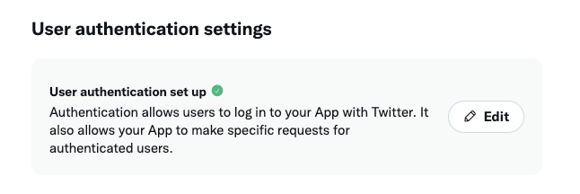
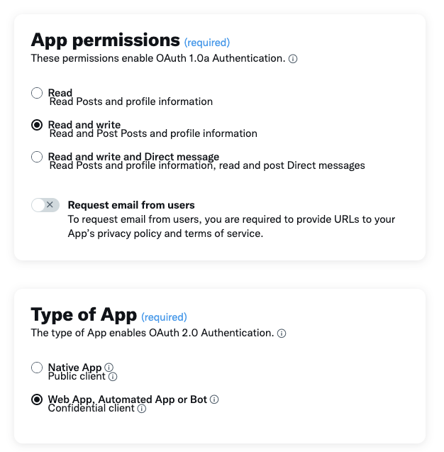
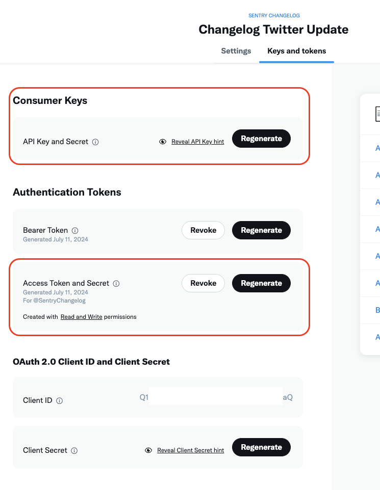
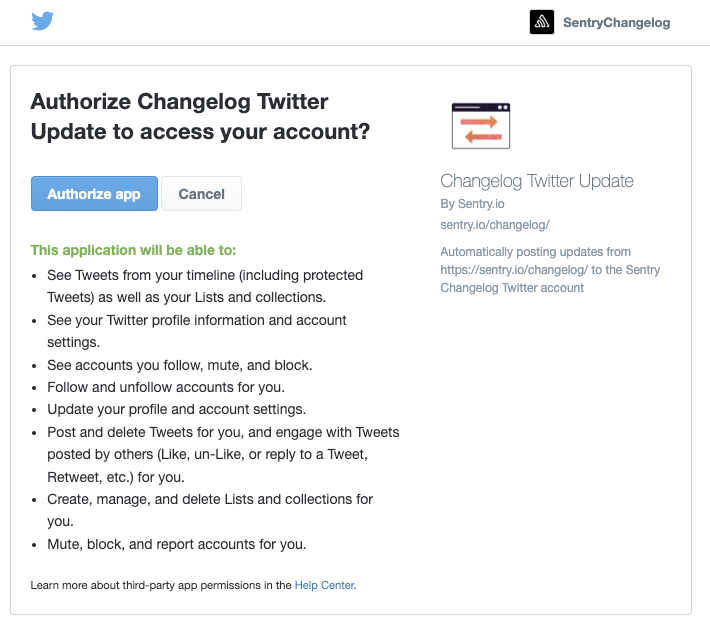

# changelog-twitter-bot
 
This is a GCP Cloud Function that listens to [Sentry Changelog](https://sentry.io/changelog/) and posts the update on the [Sentry Changelog Twitter Account](https://x.com/SentryChangelog)

# How it works

This repo defines the infrastructure and required components for a GCP cloud function that listens to webhooks and posts the data to Twitter. The intention is to update our Changelog Twitter account with updates that are posted to [Sentry Changelog](https://sentry.io/changelog/). 

We use cron job that runs every hour to check for new entries in our [Changelog Feed](https://sentry.io/changelog/feed.xml), and post them to twitter if new updates are posted.

# Setup

## GCP
The infrastructure lives in the `changelog-twitter-poster` GCP project, you can deploy the infrastructure using terraform. Terraform state is stored in the `sac-prod-tf--changelog-x` GCS bucket, and deployments run as `changelog-x-tf-apply@sac-prod-sa.iam.gserviceaccount.com`. That account's permissions inside this project are defined in `terraform/deployer.tf`; its access to the state bucket is managed in the `sac-prod` project.

```
cd terraform
terraform init
terraform plan
terraform apply
```

If you previously applied with local state, `terraform init` will offer to migrate it into the GCS backend; answer yes, then commit the generated `.terraform.lock.hcl`.

### CI/CD

Terraform runs in GitHub Actions via Workload Identity Federation (no service account keys), using two service accounts from the `sac-prod-sa` project. The emails live in `terraform/terraform.tfvars`.

| Workflow | Trigger | Identity | What it does |
|---|---|---|---|
| [`tf-plan.yaml`](.github/workflows/tf-plan.yaml) | Pull request to `main` | Plan SA (`changelog-x-tf-plan`, read-only, `terraform/planner.tf`) | `terraform plan`, posts the diff as a PR comment when there are changes |
| [`tf-apply.yaml`](.github/workflows/tf-apply.yaml) | Push to `main` | Apply SA (`changelog-x-tf-apply`, write, `terraform/deployer.tf`) | `terraform apply -auto-approve` in the `production` environment; applies are serialized |

Prerequisites, all outside this repo:

- Repository variables `WIF_PROVIDER`, `WIF_PLAN_SERVICE_ACCOUNT` and `WIF_APPLY_SERVICE_ACCOUNT`, and a `production` environment (add required reviewers there if applies should wait for approval).
- In `security-as-code`: both service accounts, the Workload Identity provider trusting this repository, and their access to the state bucket `sac-prod-tf--changelog-x` (plan: object read; apply: object admin).

The apply SA deliberately cannot change its own roles, the plan SA's roles, or the plan SA's custom role. A pull request that edits `terraform/deployer.tf` or `terraform/planner.tf` will plan fine but the CI apply will fail on those resources; apply it once locally as yourself (`terraform apply` with your user credentials), after which the CI apply is a no-op.
Once the infra is deployed, you will need to update the following secrets in GCP Secret Manager.
```
sentrychangelog_twitter_consumer_key
sentrychangelog_twitter_consumer_secret
sentrychangelog_twitter_access_token
sentrychangelog_twitter_access_token_secret
sentrychangelog_webhook_auth_header
```
The twitter ones can be retrieved in the Twitter section below.

`sentrychangelog_webhook_auth_header` is a preshared secret that's setup in Zapier's webhook as a `Authorization` header to authorize the webhooks requests.

## Twitter

> Free version of Twitter API access is sufficient for this integration.

You can visit [Twitter Developer Portal](https://developer.twitter.com/en/portal/projects-and-apps) to create a Free App for your Twitter account.

Once the app is created, edit the `User authentication settings`


Update the `App permissions` to `Read and write`, select `Web App, Automated App or Bot` as Type of App


For the App info, you can enter any URI for the required field, as we won't need them in the future. Don't forget to click save when you are done.

Next, go to the `Keys and tokens` tab, can create the Key/Secret pair for both `Consumer Keys` and `Access Token and Secret`.


These are the keys that need to be added to the GCP secret manager, please handle them securely as anyone who has access to these keys will have access to your Twitter account.

Before these key has actual access to your Twitter account, we need to go through the OAuth flow. You can use the [sample code provided by Twitter](https://github.com/xdevplatform/Twitter-API-v2-sample-code/blob/main/Manage-Tweets/create_tweet.py), remember to set the environment variables as the consumer key and secret we generated in the last step. 

While running the script, you will be asked to visit an OAuth URL and authorize the app's access to your account. After authorizing, the script will try to post a "Hello world" twitter to your account, you can use this to verify the authorization is completed successfully.


Once this is completed, update the secrets in GCP and you should be good to go!
